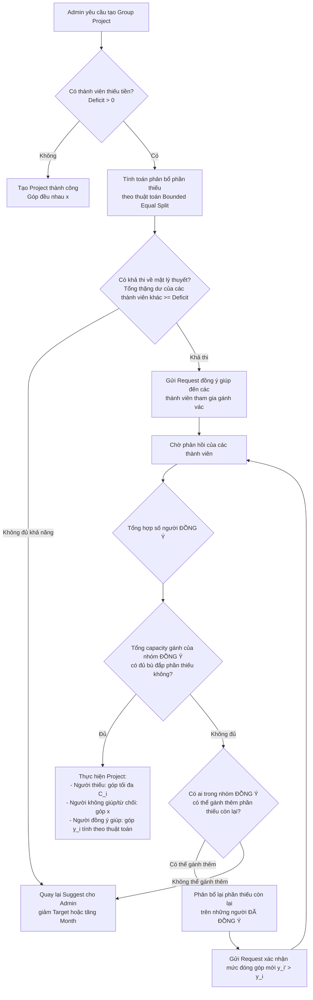

# Thuật toán Hỗ trợ Đóng góp (Sponsorship) trong Group Project

Tài liệu này mô tả chi tiết về thuật toán **Hỗ trợ đóng góp (Sponsorship)** dành cho dự án nhóm (Group Project), giúp giải quyết bài toán khi một hoặc một vài thành viên trong nhóm không đủ khả năng tài chính để đóng góp phần tiền đều nhau như ban đầu.

---

## 1. Bối cảnh & Logic Hiện tại
* **Logic Hiện tại**: 
  * Tất cả thành viên trong nhóm đóng góp một số tiền đều nhau mỗi tháng.
  * Số tiền đóng góp hàng tháng của mỗi người: $x = \frac{\text{Target Amount}}{\text{Duration (Months)} \times \text{Số thành viên}}$.
  * Nếu tồn tại **ít nhất một thành viên** có năng lực tiết kiệm (usable/saving capacity) nhỏ hơn $x$, hệ thống sẽ chặn không cho tạo project và gợi ý (suggest) phương án thay đổi mục tiêu (giảm số tiền hoặc tăng thời gian tích lũy).

* **Mục tiêu mới**: 
  * Cho phép các thành viên có năng lực tài chính tốt hơn **chia sẻ/gánh vác** phần thiếu hụt của thành viên yếu hơn nếu họ đồng ý.

---

## 2. Mô tả Thuật toán Đóng góp Giúp (Sponsorship Loop)

Giả sử nhóm có $N$ thành viên. 
* Gọi $C_i$ là hạn mức chi tiêu khả dụng (saving capacity snapshot) của thành viên $i$.
* Gọi $x$ là số tiền cần góp mỗi tháng của một người theo kế hoạch ban đầu: $x = \frac{T}{M \times N}$ (với $T$ là tổng số tiền, $M$ là số tháng).
* Tập hợp các thành viên gặp khó khăn tài chính (thiếu tiền): $S_{deficit} = \{ i \mid C_i < x \}$.
* Tổng số tiền thiếu hụt mỗi tháng: $D_{total} = \sum_{i \in S_{deficit}} (x - C_i)$.

### Sơ đồ luồng hoạt động (Workflow Flowchart)

---

## 3. Thuật toán phân bổ đóng góp: Chia đều có giới hạn trần và bù trừ phần tràn (Bounded Equal Split with Spillover)

Để đảm bảo tính **công bằng cao nhất** (tiệm cận việc chia đều), hệ thống sử dụng thuật toán phân bổ như sau thay vì loại bỏ người có thặng dư thấp:

### Các bước tính toán phân bổ:
Giả sử cần phân bổ số tiền thiếu $D$ cho tập hợp ứng viên $S_{helpers}$. Với mỗi người $j \in S_{helpers}$, thặng dư tối đa họ có thể đóng góp thêm là $U_j = C_j - x$.

1. Khởi tạo số tiền đóng góp thêm dự kiến của mỗi ứng viên: $d_j = 0$ với mọi $j$.
2. Khởi tạo tập ứng viên còn tài nguyên chưa khai thác hết: $A = S_{helpers}$.
3. Số tiền còn lại cần phân bổ: $D_{rem} = D$.
4. **Vòng lặp phân bổ**:
   * Trong khi $D_{rem} > 0$ và tập $A$ không rỗng:
     * Chia đều phần còn thiếu cho các thành viên trong tập $A$: $d_{avg} = \frac{D_{rem}}{|A|}$.
     * Tạo tập ứng viên mới sẽ bị chạm trần (cáp tối đa): $A_{capped} = \{ j \in A \mid U_j - d_j < d_{avg} \}$.
     * Nếu $A_{capped}$ rỗng:
       * Cộng thêm $d_{avg}$ cho toàn bộ thành viên trong $A$: $d_j = d_j + d_{avg}$.
       * Đặt $D_{rem} = 0$ (Hoàn tất phân bổ).
     * Nếu $A_{capped}$ không rỗng:
       * Với mỗi $j \in A_{capped}$:
         * Lượng đóng góp thêm đạt trần tối đa: $d_{add} = U_j - d_j$.
         * Cập nhật đóng góp: $d_j = C_j - x$ (góp tối đa khả năng).
         * Trừ bớt lượng đã phân bổ: $D_{rem} = D_{rem} - d_{add}$.
         * Loại $j$ ra khỏi tập đang xét: $A = A \setminus \{j\}$.
       * Với những người không bị chạm trần trong $A$ (nếu có):
         * Cộng thêm lượng trung bình tạm thời: $d_j = d_j + d_{avg}$ (sẽ tiếp tục được điều chỉnh ở vòng sau nếu cần).
         * Trừ lượng đã phân bổ: $D_{rem} = D_{rem} - (d_{avg} \times |A \setminus A_{capped}|)$.

5. **Kết quả**:
   * Nếu kết thúc vòng lặp mà $D_{rem} = 0$: Phân bổ thành công. Số tiền mỗi người giúp cần đóng góp hàng tháng là $y_j = x + d_j$.
   * Nếu $D_{rem} > 0$: Không đủ khả năng gánh vác (Thất bại) $\rightarrow$ Chuyển sang bước Suggest Admin.

### Ví dụ minh họa:
* **Đầu vào**: A thiếu 1.000.000đ. Nhóm còn B (dư 900.000đ) và C (dư 200.000đ).
* **Vòng 1**:
  * $D_{rem} = 1.000.000$đ. Tập $A = \{B, C\}$.
  * Chia đều: $d_{avg} = 1.000.000 / 2 = 500.000$đ.
  * C có thặng dư khả dụng $U_C = 200.000$đ $< 500.000$đ $\rightarrow$ C bị chạm trần ($C \in A_{capped}$).
  * Cập nhật C đóng góp tối đa: $d_C = 200.000$đ.
  * Cập nhật phần thiếu còn lại: $D_{rem} = 1.000.000 - 200.000 = 800.000$đ.
  * Loại C khỏi tập xét: $A = \{B\}$.
* **Vòng 2**:
  * Chia đều phần thiếu còn lại cho những người chưa chạm trần: $d_{avg} = 800.000 / 1 = 800.000$đ.
  * B có thặng dư khả dụng $U_B = 900.000$đ $\ge 800.000$đ $\rightarrow$ B không bị chạm trần.
  * Cập nhật B đóng góp thêm: $d_B = 800.000$đ.
  * Cập nhật phần thiếu còn lại: $D_{rem} = 800.000 - 800.000 = 0$đ.
  * Hoàn tất!
* **Kết quả cuối cùng**: C đóng góp thêm 200.000đ (tổng $x + 200k$), B đóng góp thêm 800.000đ (tổng $x + 800k$). Rất công bằng và tận dụng tối đa tài nguyên nhóm mà không bỏ sót ai!

---

## 4. Các tính năng đi kèm (Đề xuất 2 & 3)

### Đề xuất 2: Cấu hình tự động hỗ trợ (Auto-Sponsorship Settings)
* **Giải pháp**: Cho phép mỗi thành viên bật tính năng *"Tự động hỗ trợ đồng đội"* trong cài đặt nhóm, đi kèm với 2 lựa chọn cấu hình hạn mức:
  1. **Hạn mức cụ thể** (Custom Limit): Nhập số tiền cụ thể (ví dụ: $+200.000$đ/tháng).
  2. **Tối đa khả năng** (Maximum Capacity / "Tối đa có thể"): Sẵn sàng tự động hỗ trợ tối đa bằng toàn bộ phần thặng dư ngân sách khả dụng của mình ($C_j - x$) mà không cần hỏi lại.
* **Luồng xử lý tự động duyệt và gửi request**:
  * **Trường hợp 1 (Tự động duyệt)**: Khi tạo dự án, hệ thống tính toán nếu lượng đóng góp thêm $d_j$ của mọi người đều nằm trong hạn mức tự động của họ (hoặc họ chọn "Tối đa khả năng" và $d_j \le C_j - x$) thì dự án sẽ **được duyệt và kích hoạt ngay lập tức** mà không cần gửi request khảo sát qua lại mất thời gian.
  * **Trường hợp 2 (Gửi Request thủ công)**: Nếu số tiền cần đóng góp thêm $d_j$ vượt quá hạn mức tự động cụ thể đã cấu hình (nhưng vẫn nhỏ hơn thặng dư tối đa $C_j - x$):
    * Hệ thống **sẽ không tự động duyệt** mà sẽ gửi một **Request thủ công** đến thành viên đó để xin ý kiến xác nhận (Do vượt mức tự động pre-approve nhưng họ vẫn đủ khả năng chi trả).
    * Nếu họ đồng ý, dự án tiếp tục; nếu họ từ chối, hệ thống phân bổ lại theo luồng ở Mục 3.

### Đề xuất 3: Simulation trực quan cho Admin (Tránh mò mẫm)
* Khi Admin nhập số tiền mục tiêu hoặc số tháng, hệ thống hiển thị ngay một bảng dự báo (không lộ thông tin chi tiết số dư của từng người để bảo mật):
  * **Trạng thái**: *Cần hỗ trợ đóng góp.*
  * **Dự báo**: *Có 1 thành viên thiếu tổng cộng 300.000đ/tháng. Các thành viên còn lại cần gánh tối đa thêm 150.000đ/tháng. Tỷ lệ thành công dự kiến: Cao.*
